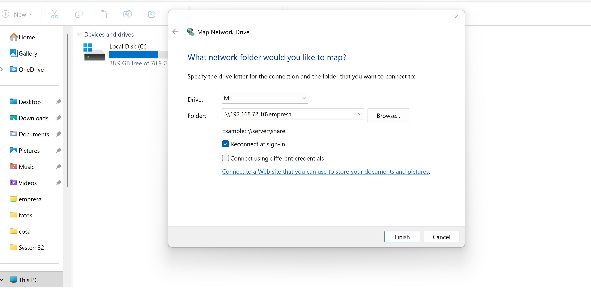
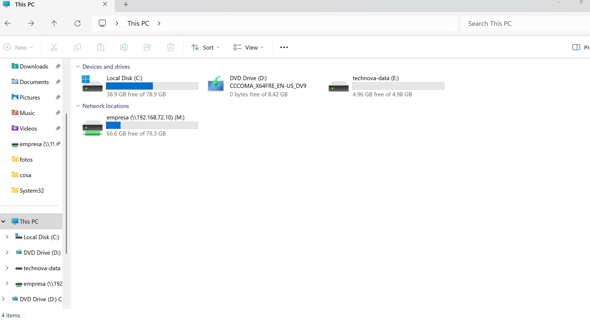
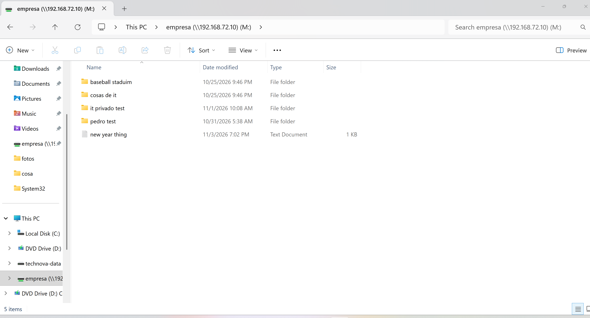
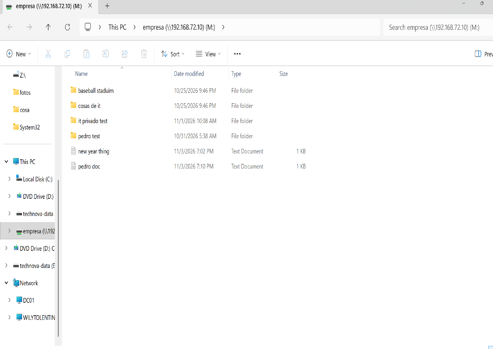
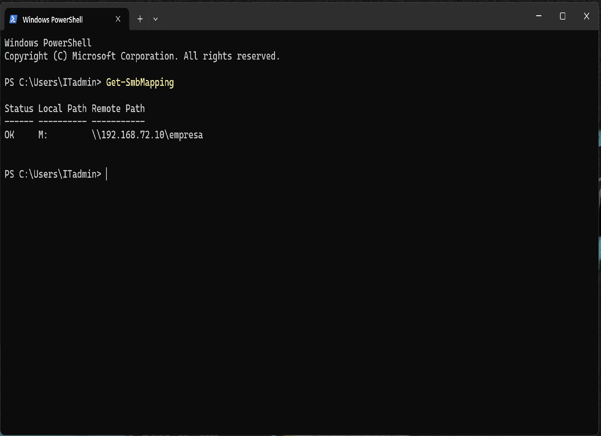
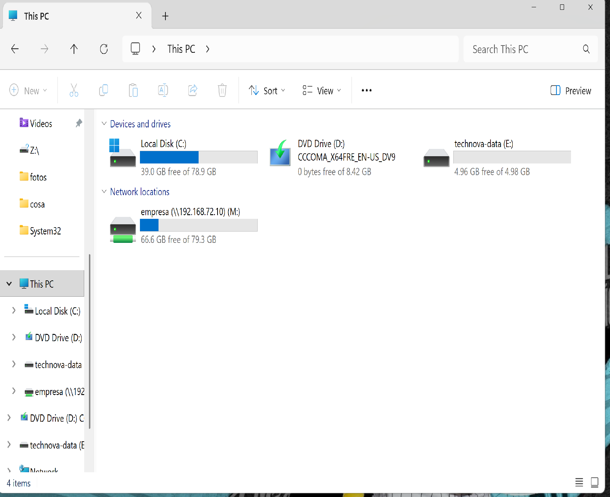

# TechNova IT Support — Ticket #1048

## Windows 11 & Windows Server 2022 — Network Drive Mapping

**Ticket Status:** Resolved  
**Priority:** Medium  
**Category:** Network Drive Mapping / SMB File Sharing  
**Environment:** Windows 11 Pro, Windows Server 2022, VMware Workstation  
**Lab Type:** Simulated IT Support Incident

---

## 1. Incident Description

An employee at TechNova needs reliable access to a shared company folder hosted on Windows Server 2022.

The IT Support Technician is responsible for mapping the shared folder as a network drive, authenticating the employee, validating file access, and ensuring the mapped drive remains available after signing out and signing back in.

## 2. Lab Environment

| Component | Configuration |
|---|---|
| Server | DC01 — Windows Server 2022 |
| Client | PC01 — Windows 11 Pro |
| Virtualization | VMware Workstation |
| Server IP | 192.168.72.10 |
| Shared Folder | `\\192.168.72.10\empresa` |
| Mapped Drive | M: |
| Protocol | SMB |
| Test Account | DC01\pedro |

## 3. Troubleshooting and Configuration

**Step 1 — Network Connectivity**

Verified communication between PC01 and DC01 and confirmed that the SMB shared folder was accessible.

**Step 2 — Network Drive Mapping**

Opened File Explorer, selected This PC, and configured a mapped network drive using the following settings:

- Drive letter: M:
- Network path: `\\192.168.72.10\empresa`
- Reconnect at sign-in: Enabled

**Step 3 — User Authentication**

Initially accessed the shared folder using the server Administrator account for testing.

Reconnected the network drive using the standard user account `DC01\pedro` to validate employee access.

**Step 4 — File Access Verification**

Created test documents from PC01 and confirmed that the files were stored on DC01.

Successfully tested file creation and access through the mapped drive.

**Step 5 — PowerShell Verification**

Executed the following command:

```powershell
Get-SmbMapping
```

Verified that the SMB connection reported:

- Status: OK
- Local Path: M:
- Remote Path: `\\192.168.72.10\empresa`

**Step 6 — Persistent Connection Testing**

Signed out of Windows 11 and signed back in.

Confirmed that the mapped drive reappeared and that the shared folder contents remained accessible.

## 4. Results

- Successfully mapped a shared network folder from Windows Server 2022 to Windows 11.
- Validated SMB authentication using a standard user account.
- Confirmed file creation and access through the mapped drive.
- Verified the connection using PowerShell.
- Confirmed access to the mapped drive after signing back in.

**Final Ticket Status: RESOLVED**

## 5. Skills Demonstrated

- Windows 11 Administration
- Windows Server 2022
- SMB File Sharing
- Network Drive Mapping
- User Authentication
- File Access Troubleshooting
- PowerShell Diagnostics
- Persistent Network Connections

## 6. Security Considerations

Standard user accounts should be used for routine access to company shared folders. Administrator credentials should be reserved for authorized administrative tasks.

SMB and NTFS permissions should follow the principle of least privilege.

## 7. Evidence

## 7. Evidence

### 1. Network Drive Configuration
Configured the M: drive to connect to the shared folder on DC01.



### 2. Mapped Network Drive
Verified that the shared folder appeared as drive M: in Windows 11 File Explorer.



### 3. File Creation Test
Created a test document through the mapped network drive to verify write access.



### 4. Standard User Access Verification
Verified that the shared folder was accessible using the standard user account and tested file creation.



### 5. PowerShell SMB Verification
Executed Get-SmbMapping and confirmed that the mapped drive reported Status: OK.



### 6. Persistent Network Drive Connection
Signed out and signed back into Windows 11, confirming that the mapped drive remained accessible.



---

**Project:** TechNova IT Support Lab  
**Ticket:** #1048 — Network Drive Mapping  
**Status:** Resolved
